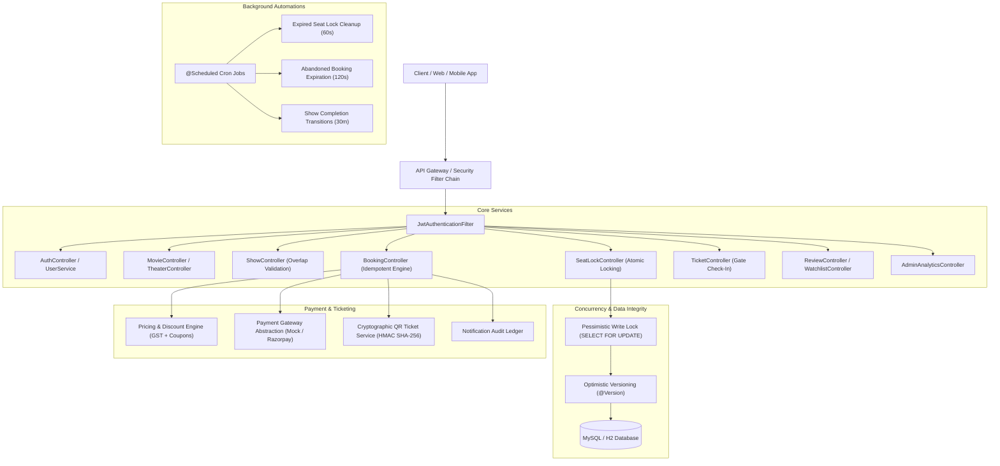

# BookMyShow - Production-Ready Backend

A complete, scalable, enterprise-grade movie ticket booking backend engineered with **Spring Boot 4.0.3**, **Java 21**, **Spring Data JPA**, **MySQL**, and **Spring Security 7 (Stateless JWT)**.

---

## 🏛️ System Architecture



---

## 🚀 Key Engineering Highlights

### 1. Atomic Seat Locking & Concurrency Protection
* **Deadlock Prevention**: Target seat IDs are sorted in ascending order prior to lock acquisition, preventing database lock-ordering deadlocks during high-traffic spikes.
* **Pessimistic Write Locking**: Uses `@Lock(LockModeType.PESSIMISTIC_WRITE)` (`SELECT ... FOR UPDATE`) on `show_seats` records so concurrent transactions wait deterministically rather than overwriting each other.
* **Optimistic Locking**: ShowSeat entities carry an `@Version` column to defend against stale in-memory writes.
* **Lock Token & Configurable TTL**: Upon successful lock acquisition, an ephemeral UUID `lockToken` is returned with a 5-minute time-to-live. Booking confirmation strictly validates ownership of this token.
* **Automated Lock Expiration**: A scheduled task purges expired locks every 60 seconds, returning inventory to `AVAILABLE`.

### 2. Show Scheduling & Overlap Collision Prevention
* Shows cannot be double-booked on the same screen. Before saving, `ShowRepository.findOverlappingShows` runs an interval overlap query:
  `startTime < newEndTime AND endTime > newStartTime`.
* Upon show scheduling, physical screen seats are automatically mapped to show-specific `ShowSeat` inventory with base price and format surcharges (e.g., IMAX, 3D).

### 3. Transparent Pricing & Coupon Engine
* **Base Seat Price**: Configured per seat category (`STANDARD`, `PREMIUM`, `RECLINER`).
* **Format Surcharge**: Additional surcharge for premium screen formats.
* **Convenience Fee**: Configurable per-ticket fee with itemized 18% GST (CGST + SGST).
* **Coupons**: Supports `PERCENTAGE` discounts (with maximum discount caps) and `FLAT` discounts, complete with minimum order requirements, expiration dates, and usage limits.
* **Historic Immutability**: All price components and applied coupons are persisted on the `Booking` entity to ensure past invoices remain unchanged if theater pricing updates later.

### 4. Idempotent Booking State Machine
* **States**: `PENDING_PAYMENT` -> `CONFIRMED` -> `CANCELLED` / `EXPIRED` / `REFUNDED`.
* **Idempotency**: Supports `Idempotency-Key` header on booking submissions. Retrying an identical request returns the established booking without re-charging the customer.
* **Cancellation Cut-Off**: Bookings can only be cancelled up to 2 hours before showtime. Cancellations automatically release seats and invoke gateway refund flows.

### 5. Cryptographic QR Tickets & Gate Check-In
* On confirmation, an entry pass is generated with a unique ticket number and a cryptographic HMAC SHA-256 signature:
  `BMS:<ticketNumber>:<hmacSignature>`.
* Staff scanners invoke `POST /api/tickets/check-in` with the QR payload or ticket number. Duplicate scan attempts are immediately rejected with informative audit timestamps.

### 6. Admin Analytics & Metrics
* Real-time metrics via `GET /api/admin/analytics`:
  * Gross Booking Value (GBV)
  * Net Revenue (GBV - Refunds)
  * Confirmed vs. Cancelled Booking Counts
  * Theater Occupancy Percentage Rate
  * Top Grossing Movies Ranking

---

## 🛠️ Technology Stack

| Component | Technology |
|---|---|
| Language | Java 21 (LTS) |
| Framework | Spring Boot 4.0.3 |
| Security | Spring Security 7, JJWT 0.12.6, BCrypt |
| Persistence | Spring Data JPA, Hibernate, MySQL 8.0+ |
| In-Memory Test DB | H2 Database |
| Build Tool | Apache Maven 3.9+ |
| Serialization | Jackson (JavaTimeModule) |

---

## 📋 Complete REST API Directory

### Authentication & Account Security (`/api/auth`, `/api/users`)
| Method | Endpoint | Access | Description |
|---|---|---|---|
| `POST` | `/api/auth/register` | Public | Register new customer account |
| `POST` | `/api/auth/login` | Public | Login with email and password, returns JWT & Refresh token |
| `POST` | `/api/auth/refresh` | Public | Exchange refresh token for fresh access token (Token Rotation) |
| `POST` | `/api/auth/logout` | Authenticated | Revoke refresh token and logout |
| `GET` | `/api/users/me` | Authenticated | Get current authenticated user profile |
| `PUT` | `/api/users/me` | Authenticated | Update user name and phone number |
| `POST` | `/api/users/change-password` | Authenticated | Change account password |

### Movies Catalog & Discovery (`/api/movies`)
| Method | Endpoint | Access | Description |
|---|---|---|---|
| `GET` | `/api/movies` | Public | List movies (filters: `search`, `genre`, `language`, `status`) |
| `GET` | `/api/movies/{id}` | Public | Get movie details by ID |
| `GET` | `/api/movies/city/{city}` | Public | Discover movies showing in a specific city |
| `POST` | `/api/movies` | Admin | Add new movie |
| `PUT` | `/api/movies/{id}` | Admin | Update movie details |
| `DELETE` | `/api/movies/{id}` | Admin | Soft-delete movie |

### Cities, Theaters & Screens (`/api/cities`, `/api/theaters`, `/api/screens`)
| Method | Endpoint | Access | Description |
|---|---|---|---|
| `GET` | `/api/cities` | Public | List active cities |
| `POST` | `/api/cities` | Admin | Register new city |
| `GET` | `/api/theaters` | Public | List theaters (filter by `city`) |
| `GET` | `/api/theaters/{id}` | Public | Get theater details |
| `POST` | `/api/theaters` | Admin | Register new theater |
| `GET` | `/api/screens/theater/{theaterId}` | Public | List screens in a theater |
| `POST` | `/api/screens` | Admin | Create screen with automatic seat layout generation |

### Show Scheduling & Seating (`/api/shows`)
| Method | Endpoint | Access | Description |
|---|---|---|---|
| `GET` | `/api/shows` | Public | Search shows by `movieId`, `city`, `date`, `format`, `language` |
| `GET` | `/api/shows/{id}` | Public | Get show details with seat pricing |
| `GET` | `/api/shows/{id}/seats` | Public | Complete real-time seating layout (`AVAILABLE`, `LOCKED`, `BOOKED`) |
| `POST` | `/api/shows` | Admin | Schedule show with screen collision validation |
| `POST` | `/api/shows/{id}/cancel` | Admin | Cancel show and release locked seats |
| `POST` | `/api/shows/{id}/lock` | Authenticated | Atomically lock selected seats (5-min TTL) |
| `POST` | `/api/shows/{id}/unlock` | Authenticated | Manually release locked seats |
| `POST` | `/api/shows/locks/cleanup` | Admin | Trigger expired lock sweep |

### Bookings, Pricing & Gate Check-In (`/api/bookings`, `/api/tickets`, `/api/coupons`)
| Method | Endpoint | Access | Description |
|---|---|---|---|
| `POST` | `/api/bookings/calculate-price` | Public | Preview price breakdown with convenience fee, GST, and coupon |
| `POST` | `/api/bookings` | Authenticated | Create booking (`Idempotency-Key` supported) |
| `GET` | `/api/bookings/my-bookings` | Authenticated | List bookings of logged-in customer |
| `GET` | `/api/bookings/{id}` | Authenticated | Get booking details (Resource-level authorization protected) |
| `POST` | `/api/bookings/{id}/cancel` | Authenticated | Cancel booking and trigger gateway refund |
| `GET` | `/api/tickets/{ticketNumber}` | Authenticated | View ticket pass |
| `POST` | `/api/tickets/check-in` | Admin/Support | Validate and scan entry ticket (tamper-proof QR check) |
| `GET` | `/api/coupons` | Public | List active discount coupons |
| `POST` | `/api/coupons` | Admin | Create new coupon code |

### Reviews, Watchlists & Admin Analytics (`/api/reviews`, `/api/watchlist`, `/api/admin`)
| Method | Endpoint | Access | Description |
|---|---|---|---|
| `GET` | `/api/reviews/movie/{movieId}` | Public | List ratings and reviews for a movie |
| `POST` | `/api/reviews` | Authenticated | Submit 1-5 star review and recalculate movie average |
| `GET` | `/api/watchlist` | Authenticated | Get customer's saved watchlist |
| `POST` | `/api/watchlist/{movieId}` | Authenticated | Bookmark movie to watchlist |
| `DELETE` | `/api/watchlist/{movieId}` | Authenticated | Remove movie from watchlist |
| `GET` | `/api/admin/analytics` | Admin | View real-time dashboard analytics (GBV, net revenue, occupancy %) |

---

## ⚙️ Configuration & Environment Variables

Copy `.env.example` to `.env` or set the environment variables:

| Variable | Description | Default |
|---|---|---|
| `DB_HOST` | MySQL database host | `localhost` |
| `DB_PORT` | MySQL database port | `3306` |
| `DB_NAME` | Database name | `bookmyshow` |
| `DB_USER` | Database username | `root` |
| `DB_PASSWORD` | Database password | `root` |
| `JWT_SECRET` | Secret key for JWT signing | *(Base64 secret)* |
| `JWT_EXPIRATION_MS` | Access token TTL in milliseconds | `86400000` (24h) |
| `JWT_REFRESH_EXPIRATION_MS` | Refresh token TTL in milliseconds | `604800000` (7 days) |

---

## 🧪 Testing

The test suite runs against an isolated in-memory H2 database with zero external dependencies.

```bash
# Run all tests
mvn test

# Run specific integration tests
mvn test -Dtest=ShowAndSeatLockIntegrationTest
mvn test -Dtest=EndToEndBookingAndLifecycleIntegrationTest
mvn test -Dtest=AuthControllerIntegrationTest
```

