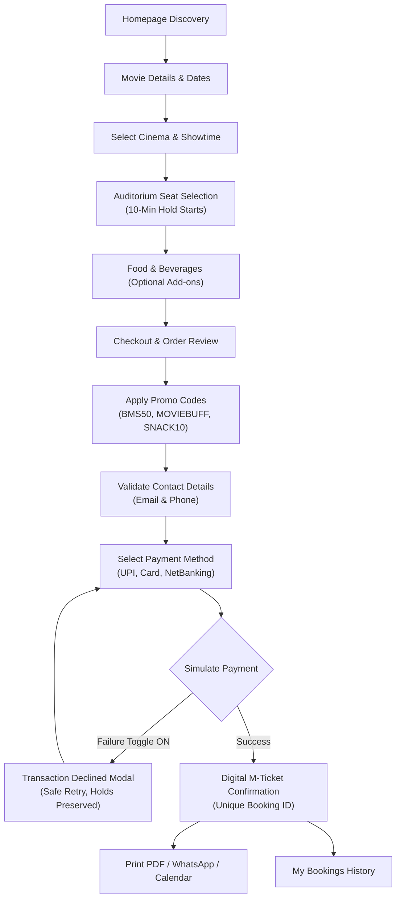

# BookMyShow Frontend — Movie Ticket Booking Platform

A complete, production-quality **BookMyShow-inspired movie ticket booking frontend** built with **React 18+**, **Vite**, **Tailwind CSS v4**, **React Router 7**, and **Lucide React**.

The application provides a seamless, end-to-end cinematic ticket booking journey: discovering trending movies, filtering by genre and language, choosing city-based cinema halls and showtimes, selecting auditorium seats across multiple tiers, pre-ordering concession snacks, applying promo discounts, completing simulated payments, and viewing/printing a digital M-Ticket boarding pass.

---

## 🎨 Mandatory Visual Design System

The application strictly implements the required 5-color palette across all components:

| Color | Hex | Primary Purpose in UI |
|---|---|---|
| **Crimson Red** | `#D64045` | Primary booking buttons, critical actions, selected seats, brand ticket accents |
| **Mint White** | `#E9FFF9` | High-contrast readable typography, clean light surfaces |
| **Soft Aqua** | `#9ED8DB` | Active filter chips, selection rings, focus indicators, subtle highlights |
| **Steel Blue** | `#467599` | Secondary surfaces, elevated cards, metadata badges, supporting borders |
| **Midnight Navy** | `#1D3354` | Main cinematic background, header navigation, footer, dark containers |

---

## 🚀 Key Features

1. **Global Header & Discovery Navigation:**
   - Stylized `bookmyshow` brand wordmark with Crimson Red ticket accent.
   - Live interactive search bar across movie titles, actors, genres, and languages with suggestions dropdown and escape key handling.
   - Interactive City Selector (Mumbai, Delhi-NCR, Bengaluru, Hyderabad, Chandigarh, Pune) which updates cinema listings in real-time.
   - Category navigation: Movies, Live Events, Plays, Sports, and Activities.
   - Notification drawer with read/unread indicators and direct ticket links.
   - Watchlist / Favorites counter.
   - One-click simulated authentication modal (Sign In / Sign Up) with preset profiles.
   - Persistent **Resume Booking Banner** that alerts users when an in-progress seat hold is active with a live countdown.

2. **Cinematic Homepage:**
   - Hero billboard carousel featuring high-res cinematic backdrops, ratings, certifications, formats, and synopsis.
   - Interactive Watch Trailer modal with video playback.
   - Live filtering by Genre (Action, Sci-Fi, Drama, Thriller, Comedy, Romance, Animation) and Language (English, Hindi, Telugu, Tamil).
   - Dynamic sorting by Popularity, Top Rated, and New Releases.
   - Sections for Now Showing, Top Rated, Trending, Live Events, and Promotional Bank Offers.

3. **Movie Details & Showtime Selection:**
   - High-definition movie backdrop, poster, certification, runtime, formats (IMAX 3D, 4DX, 2D, 3D), and language tags.
   - Expandable synopsis and cast/crew photo cards.
   - Interactive "Rate Now" 10-star rating modal with instant feedback.
   - Dynamic 6-day date picker (Today, Tomorrow, and upcoming dates generated dynamically).
   - City-filtered cinema hall directory with distance, amenities (M-Ticket, F&B, Wheelchair Accessible, Dolby Atmos), and price ranges.
   - Interactive showtime chips color-coded by availability: Available (Soft Aqua), Filling Fast (Amber), Sold Out (Disabled gray).

4. **Auditorium Seat Selection:**
   - Screen indicator with curved visual illumination: **"ALL EYES THIS WAY"**.
   - Ticket count picker (1, 2, 3, 4, 5, 6, 8, 10 tickets).
   - Three auditorium tiers:
     - **VIP Recliner** (Rows A–B) — ₹450
     - **Prime Lounger** (Rows C–F) — ₹280
     - **Classic Comfort** (Rows G–K, excluding I for realism) — ₹180
   - Left, Center, and Right blocks separated by realistic walkways/aisles.
   - Seat validation enforcing maximum ticket count constraint and disabling occupied seats.
   - Sticky bottom summary dock displaying selected seat labels, subtotal, and "Proceed to Add-ons" CTA.

5. **Food & Beverages Concessions:**
   - Concession catalog categorized into Combos, Popcorn, Beverages, and Gourmet Snacks.
   - Popcorn tubs (Caramel, Cheddar Cheese, Salted), Nachos with Cheese, Pepsi, Himalayan Water, Brownie, and Wraps.
   - Veg / Non-veg indicators, calorie counts, and working quantity (+ / -) counters.
   - Real-time subtotal updates with visible "Skip F&B" button.

6. **Order Review, Coupons & Checkout:**
   - **Active 10-minute seat hold countdown timer** with visual progress bar and expiry protection.
   - Transparent itemized order summary (tickets, F&B, ₹30/ticket convenience fees, 18% GST, promo discount, total amount).
   - Coupon promo engine supporting:
     - `BMS50` — Flat ₹50 off on orders above ₹300.
     - `MOVIEBUFF` — 15% off up to ₹150 on orders above ₹500.
     - `SNACK10` — 10% off F&B up to ₹100.
     - `FIRSTSHOW` — Flat ₹100 off on orders above ₹600.
   - Real-time client-side contact validation (Email & Indian 10-digit phone number).
   - Interactive payment tabs:
     - **UPI**: UPI ID validation, demo QR code graphic visual, GPay/PhonePe/Paytm badges.
     - **Card**: Cardholder name, card number, expiry, CVV demo inputs with explicit safety notices.
     - **Net Banking**: Selectable banks (HDFC, ICICI, SBI, Axis).
   - **QA Demo Failure Simulation Toggle** to test transaction decline and safe retry without creating duplicate bookings.

7. **Digital M-Ticket Confirmation:**
   - Animated success confirmation with unique booking ID (e.g., `BMS-MUM-892341`).
   - Cinema boarding pass ticket with perforated edges, cinema barcode visual, and entry QR graphic.
   - Actions:
     - **Print / Save PDF**: Print-friendly stylesheet via `window.print()`.
     - **Share on WhatsApp**: Opens pre-filled WhatsApp share link.
     - **Add to Calendar**: Pre-fills Google Calendar event.
     - **My Bookings**: Navigates to booking history.
     - **Book Another Movie**: Resets active flow and returns home.

8. **My Bookings & Watchlist:**
   - Saved tickets history persisted in browser localStorage.
   - Detailed ticket view and interactive booking cancellation with simulated refund.
   - Favorites / Watchlist page.

---

## 🔄 Booking Lifecycle Architecture



---

## 🛠️ Tech Stack

- **Framework:** React 19 / 18+ (Vite 8)
- **Styling:** Tailwind CSS v4 (`@tailwindcss/vite`)
- **Icons:** Lucide React
- **Routing:** React Router v7 (`react-router-dom`)
- **State Management:** React Context API (`BookingContext`, `AuthContext`) + Custom Hooks
- **Testing:** Vitest + React Testing Library + `@testing-library/jest-dom` + `jsdom`

---

## 📂 Project Structure

```text
bookmyshow-frontend/
├── public/
│   ├── favicon.svg
│   └── icons.svg
├── src/
│   ├── assets/
│   ├── components/
│   │   ├── common/
│   │   │   ├── Badge.jsx
│   │   │   ├── Button.jsx
│   │   │   ├── EmptyState.jsx
│   │   │   ├── ImageWithFallback.jsx
│   │   │   ├── Modal.jsx
│   │   │   ├── RatingModal.jsx
│   │   │   ├── Toast.jsx
│   │   │   └── TrailerModal.jsx
│   │   ├── layout/
│   │   │   ├── AuthModal.jsx
│   │   │   ├── CitySelectorModal.jsx
│   │   │   ├── Footer.jsx
│   │   │   ├── Header.jsx
│   │   │   ├── NotificationDrawer.jsx
│   │   │   ├── ResumeBookingBanner.jsx
│   │   │   └── SearchDropdown.jsx
│   │   ├── movie/
│   │   │   ├── CastList.jsx
│   │   │   ├── HeroCarousel.jsx
│   │   │   ├── MovieCard.jsx
│   │   │   └── MovieFilter.jsx
│   │   ├── cinema/
│   │   │   ├── CinemaCard.jsx
│   │   │   ├── DateSelector.jsx
│   │   │   └── ShowtimeChip.jsx
│   │   ├── seats/
│   │   │   ├── ScreenIndicator.jsx
│   │   │   ├── SeatGrid.jsx
│   │   │   ├── SeatLegend.jsx
│   │   │   ├── SeatSummaryDock.jsx
│   │   │   └── TicketCountPicker.jsx
│   │   ├── food/
│   │   │   ├── FoodCard.jsx
│   │   │   ├── FoodCartSummary.jsx
│   │   │   └── FoodCategoryTabs.jsx
│   │   ├── checkout/
│   │   │   ├── BookingTimer.jsx
│   │   │   ├── ContactForm.jsx
│   │   │   ├── CouponSection.jsx
│   │   │   ├── DemoFailureToggle.jsx
│   │   │   ├── OrderSummary.jsx
│   │   │   └── PaymentTabs.jsx
│   │   └── ticket/
│   │       ├── DigitalTicket.jsx
│   │       └── TicketActions.jsx
│   ├── context/
│   │   ├── AuthContext.jsx
│   │   └── BookingContext.jsx
│   ├── data/
│   │   ├── cities.js
│   │   ├── cinemas.js
│   │   ├── coupons.js
│   │   ├── events.js
│   │   ├── foodItems.js
│   │   ├── movies.js
│   │   ├── seats.js
│   │   └── showtimes.js
│   ├── pages/
│   │   ├── CheckoutPage.jsx
│   │   ├── ConfirmationPage.jsx
│   │   ├── EventsPage.jsx
│   │   ├── FavoritesPage.jsx
│   │   ├── FoodBeveragePage.jsx
│   │   ├── HomePage.jsx
│   │   ├── MovieDetailsPage.jsx
│   │   ├── MyBookingsPage.jsx
│   │   ├── NotFoundPage.jsx
│   │   └── SeatSelectionPage.jsx
│   ├── test/
│   │   ├── setup.js
│   │   ├── components.test.jsx
│   │   ├── formatters.test.js
│   │   ├── pricing.test.js
│   │   ├── seats.test.js
│   │   └── validation.test.js
│   ├── utils/
│   │   ├── formatters.js
│   │   ├── pricing.js
│   │   └── validation.js
│   ├── App.jsx
│   ├── index.css
│   └── main.jsx
├── .env.example
├── package.json
├── vite.config.js
└── README.md
```

---

## 💻 Installation and Setup

### Prerequisites
- Node.js (v18+ or v20+ recommended, tested on Node v24.19.0)
- npm (v9+)

### Installation
```bash
# Navigate to the frontend directory
cd bookmyshow-frontend

# Install dependencies
npm install
```

### Running Development Server
```bash
npm run dev
```
The application will launch at `http://localhost:5173`.

### Running Automated Test Suite
```bash
# Run Vitest test suite once
npm test

# Run tests in watch mode
npm run test:watch
```

### Building for Production
```bash
npm run build
```
Production assets are generated in the `dist/` directory.

### Preview Production Build Locally
```bash
npm run preview
```

---

## 🎟️ Pricing and Fee Structure

All financial calculations are centralized in `src/utils/pricing.js`:

1. **Ticket Subtotal:** Sum of prices for selected seats (`VIP`: ₹450, `Prime`: ₹280, `Classic`: ₹180).
2. **Food Subtotal:** Sum of (`item.price` × `quantity`).
3. **Convenience Fee:**
   - ₹30 per cinema ticket.
   - ₹15 flat handling fee when Food & Beverages items are ordered.
4. **Taxes:** 18% Integrated Goods and Services Tax (GST) applied on convenience fees.
5. **Coupons:**
   - Discounts are verified against minimum order threshold (`minOrder`).
   - Percentage discounts respect configured maximum caps (`maxDiscount`).
   - Discounts cannot exceed the order subtotal or generate negative balances.
6. **Final Amount Payable:**
   $$\text{Final Total} = \max(0, \text{Ticket Subtotal} + \text{Food Subtotal} + \text{Convenience Fee} + \text{GST} - \text{Discount})$$

---

## 🔒 Demo Limitations & Future Production Backend Integration

### Client-side Demo Nature
- **Simulated Seat Locking:** Seat holds are managed client-side via React state and local storage. Multi-user concurrency requires server-side Redis/RDBMS optimistic locking.
- **Simulated Payment Gateway:** No real banking transactions occur. The checkout interface demonstrates payment options with an instant simulated delay (1.5s).
- **Simulated Authentication:** Login/signup actions update in-memory state and localStorage without contacting an external identity provider.
- **M-Ticket Entry:** The barcode and QR graphic displayed on digital tickets are demo visual elements for demonstration.

### Connecting to a Real Backend
In the future, the application can be seamlessly connected to the accompanying Spring Boot backend (`bookmyshow-backend`):
1. Configure `VITE_API_BASE_URL` in `.env`.
2. Replace mock data imports in `BookingContext` with Axios API calls to `/api/movies`, `/api/shows`, `/api/seats/lock`, and `/api/bookings`.
3. In `SeatSelectionPage`, invoke `POST /api/seat-lock/lock` to acquire temporary distributed seat locks.
4. Replace simulated payment with a payment gateway webhook (e.g. Razorpay / Cashfree / Stripe).
